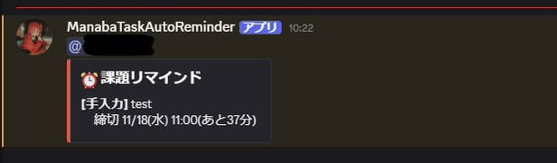
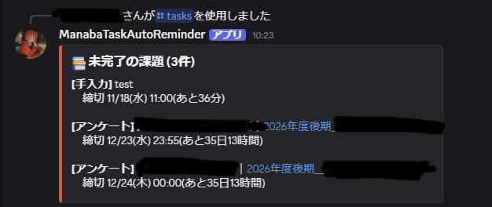

# manaba-reminder-bot

manaba（千葉工業大学の課題提出サイト）の**未提出課題を自動で取得し、締切が近づくほど頻繁にDiscordへ通知する**個人用Botです。

> 課題の見落としをなくすため、今まで「手入力でタスクを登録するBot」として使っていたものを「manabaから課題を自動で拾うBot」に作り直しました。





## 特徴

- **自動取得**：manabaにログインし、小テスト・アンケート・レポートの未提出課題（タイトル・科目・締切）を30分おきに取得
- **変更可能なリマインド**：締切までの残り時間に応じて通知間隔を変更

  | 残り時間 | 通知間隔 |
  |---|---|
  | 7日より先 | 通知しない |
  | 3日〜7日 | 24時間おき |
  | 1日〜3日 | 12時間おき |
  | 12時間〜1日 | 6時間おき |
  | 3時間〜12時間 | 3時間おき |
  | 3時間未満 | 1時間おき |
  | 期限切れ | 通知しない |

- **関係のある課題だけを通知**：締切が7日より先の課題は、定期リマインドの対象外（`REMIND_WITHIN_DAYS` で変更可。新規検出の通知と `/tasks` では表示）
- **差分検出**：新しい課題・締切の変更を検出して通知。提出して一覧から消えた課題は自動で完了扱い
- **スラッシュコマンド**：
`/tasks`未完了の課題を締切順に表示 `/sync`データ取得をすぐに行う `/add`手入力で課題一覧に登録 `/done`手入力で課題一覧から完了にする `/remove`手入力で課題一覧から削除 `/status`Botの状態を確認
- **手入力にも対応**：manabaにない予定は `/add` で追加
- **`/done`と `/remove`の違い**：`/done`は課題提出時に使用。「完了」としてマークされるため以降のmanabaからの自動取得で検出されなくなる。 `/remove`削除するだけのため以降のmanabaからの自動取得でも検出される。手入力で期限を間違えてしまった時などに使用。

## 仕組み

```
manaba ──(ログイン・HTML取得)──▶ 解析 ──▶ SQLite（差分判定）──▶ Discord通知
 30分おき                                      │
                                               └─ 5分おきにリマインド判定
```

取得・保存・通知の3層に分け、間に必ずDBを挟んでいます。manabaが一時的に不調でも通知が続き、前回との差分も取れます。

## 技術スタック

| 分類 | 使ったもの | 用途・選んだ理由 |
|---|---|---|
| 言語 | Python 3.14 で動作確認 | 使用できる言語のため |
| Discord | discord.py | 無料でBotを作成できる。スマホでも同期して使用可能なため |
| manaba取得 | requests / BeautifulSoup4 (lxml) | 公式APIがないため、ログイン -> HTML解析で取得。の流れをプログラムで制作 |
| データ保存 | SQLite（標準ライブラリ） | 一人で使う想定でサーバが不要なため。また、mm学校の講義内でも使用したことがあるため |
| 設定管理 | python-dotenv | トークン・パスワードを `.env` に分離し、コードに書かないことで設定も変更しやすく、公開時の個人情報保護にもつながる |
| 日時 | zoneinfo / tzdata | 締切を日本時間（JST）で一貫して扱う |
| テスト | pytest ＋ 模擬サーバー | 本物のmanabaに接続せず、ログイン -> 解析 -> 通知の流れを自動テスト。サーバーに負荷をかけないためにも模擬サーバーで自動テストを行う |

Python 3.14 / discord.py / requests / BeautifulSoup4 (lxml) / SQLite / pytest

## セットアップ

```bash
git clone https://github.com/<ユーザー名>/manaba-reminder-bot.git
cd manaba-reminder-bot
python -m venv venv
venv\Scripts\activate          # Windows
python -m pip install -r requirements.txt
```

1. [Discord Developer Portal](https://discord.com/developers/applications) でBotを作成し、トークンを取得
2. 自分のサーバーを作成しておく。また、Discordの「チャンネルID」「サーバーID」「ユーザーID」も保存しておく。
3. [Discord Developer Portal] で「OAuth2」->「URL Generator」と進みスコープで`bot` と `applications.commands` にチェック -> 自分のサーバーに招待
4. `.env.example` を `.env` にコピーして、各値を入力
5. 取得だけを先に確認：`python manaba_bot.py --check`
6. Botを起動：`python manaba_bot.py`

詳しい手順とコードの解説は [`docs/解説.txt`](docs/解説.txt) を参照してください。

## コマンド

| コマンド | 内容 |
|---|---|
| `/tasks` | 未完了の課題を締切順に表示 |
| `/sync` | データ取得をすぐに行う |
| `/done` | 手入力で課題一覧から完了にする |
| `/add` | 手入力で課題一覧に登録 |
| `/remove` | 手入力で課題一覧から削除 |
| `/status` | Botの状態を確認 |

## テスト

manabaに似せた模擬サーバーを使うので、本物のmanabaやDiscordには接続しません。

```bash
pip install pytest
python -m pytest -q
```

## 設計上の工夫

- **ログインのID/パスワード送信は1回だけ**：失敗の繰り返しによるアカウントロックを防ぎ、3回連続で失敗したら自動同期を停止
- **「0件」と「解析失敗」を区別**：画面が変わって読めなかった場合に、誤全課題をって提出済みにしない
- **取得に失敗した種類はDBを変更しない**：一部の失敗が他のデータに波及しない
- **2回連続で一覧から消えたら自動完了**：一時的な取得ミスによる誤判定を避けるため
- **表の列を見出しの文言で判断**：列の順番を決め打ちせず、画面の小さな変更に強くする
- **重い通信は別スレッドで実行**：Botの接続維持を妨げない
- **秘密情報は `.env` に記載**：コードを公開してもパスワード・トークンは漏れない

## 注意事項

- **個人利用が前提** manabaには公式の公開APIがないため、ログインして画面を読み取る方式を使用。**学内の利用規約・情報セキュリティの規程を、各自で確認してください。**
- アクセス頻度は、1秒以上の間隔・同期は最短15分に制限しています。
- manabaの画面仕様が変わると、取得できなくなる可能性があります（`--check --dump-html` で原因を調べられます）。
- ID/パスワード・トークンは `.env` にのみ置き、公開しないでください。
- 動作確認：模擬サーバーとpytestで確認済みです。千葉工大manabaで動作確認済み（2026 11/17）

## ディレクトリ構成

```
manaba-reminder-bot/
├── manaba_bot.py        # Bot本体
├── requirements.txt
├── .env.example         # 設定のひな形（コピーして .env にする）
├── docs/
│   └── 解説.txt          # コードの自作指導書
└── tests/
    ├── fake_manaba_server.py   # 模擬サーバー
    ├── conftest.py
    └── test_manaba_bot.py
```

## ライセンス

MIT License